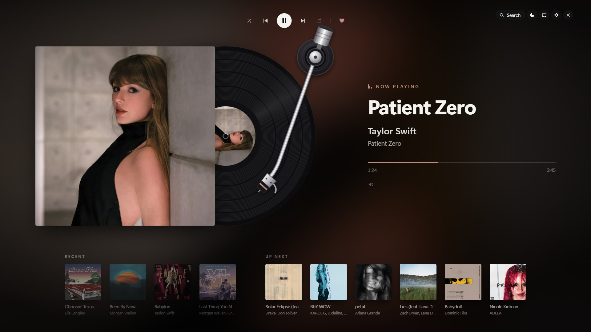
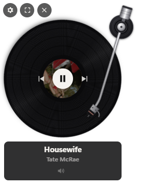
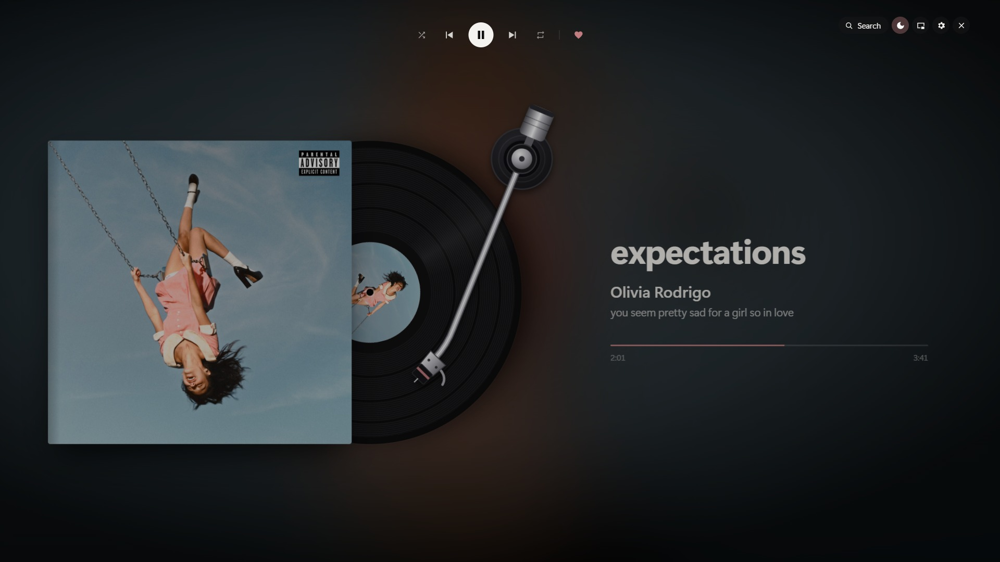
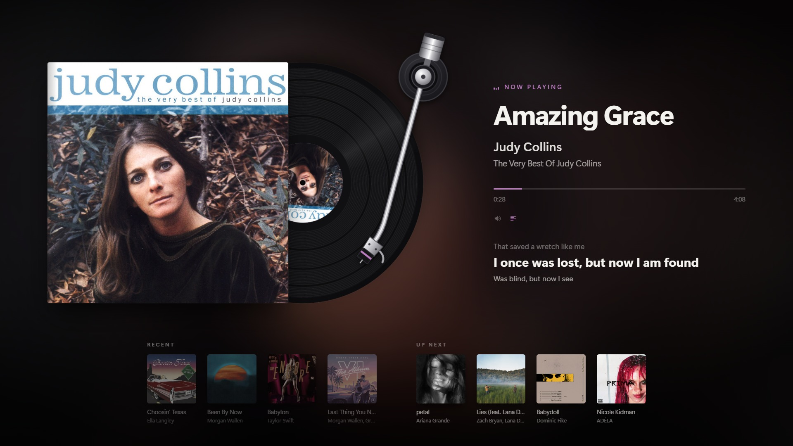
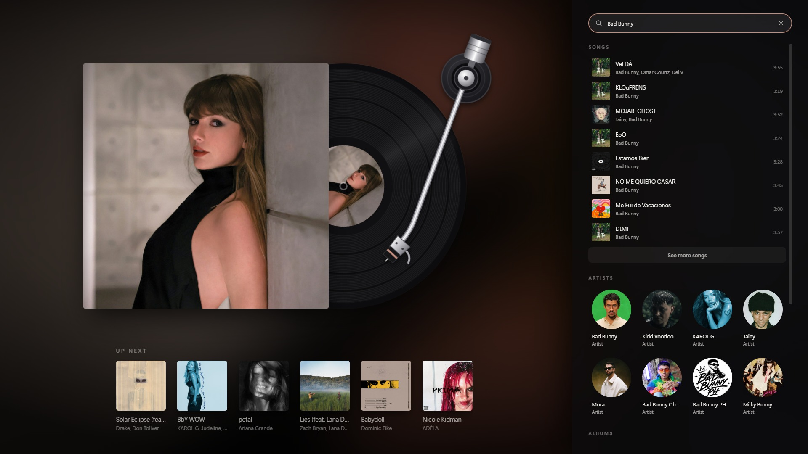
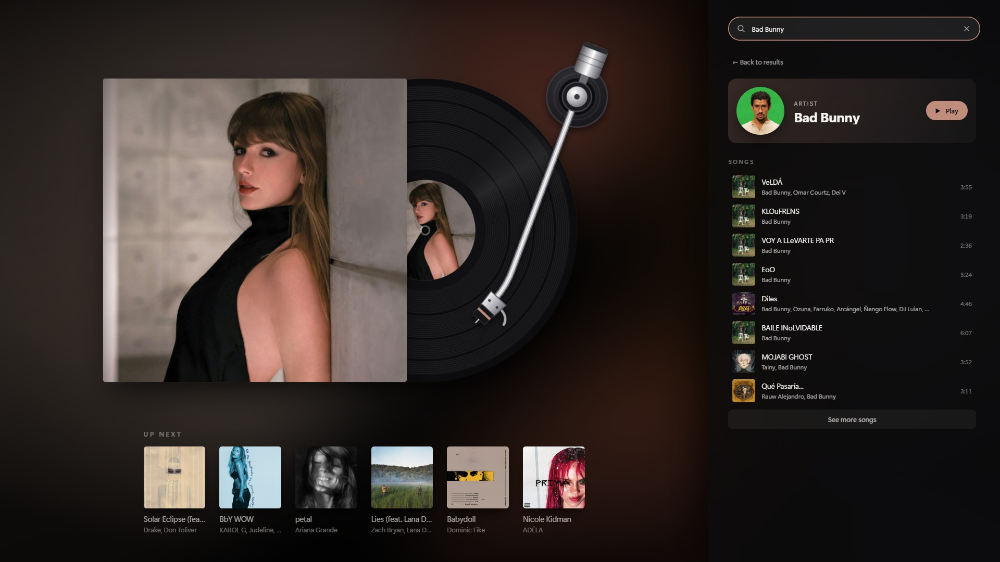
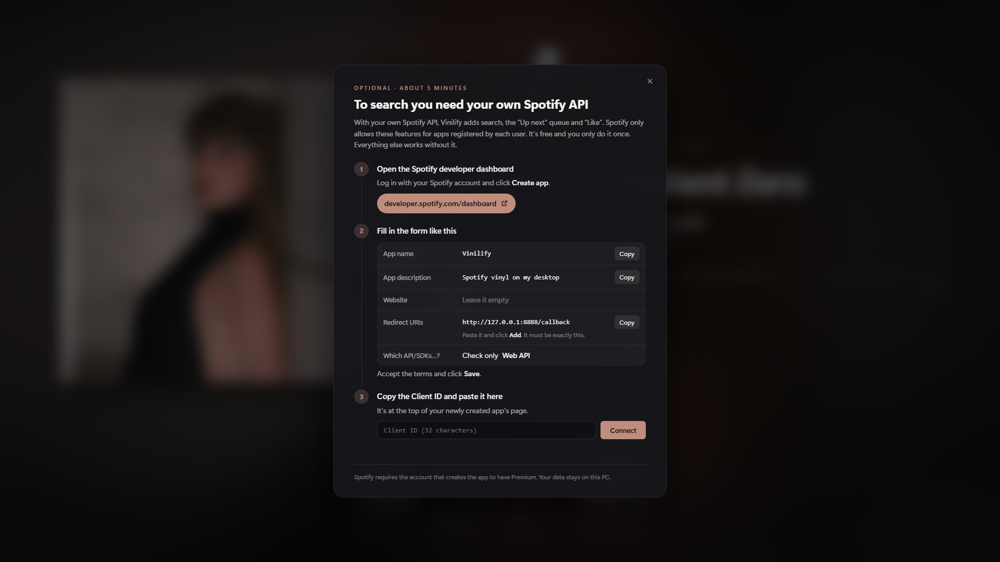

# Vinilify 💿

**English** · [Español](README.es.md)

Whatever is playing on your Spotify, as a spinning vinyl record. No accounts, no setup: open Spotify on your PC and the record starts spinning.



- **Floating mini vinyl**: always on top of other windows. Drag it with the mouse; hover over it to see the song, the controls and the volume. Double-click to open full screen.
- **Full screen**: opens on the display you choose (the secondary one by default). Shows the record in its sleeve, a tonearm that moves along with the song, a background tinted with the cover's colors, **synced lyrics** and the covers of what played before. It has shuffle, repeat and Like. While it's open, the monitor won't go to sleep.
- **Screen protection mode**: for leaving it on a second display. Dims the image, keeps only the record, title, artist, album and timeline, and drifts very slowly so nothing stays in the same spot. Turn it on with the moon button, or it kicks in by itself after 5 minutes without the mouse over the window.
- **In English and Spanish**: pick it during installation and change it anytime in ⚙ Settings.

| Mini vinyl | Protection mode |
|---|---|
|  |  |

**Synced lyrics**, hidden by default: turn them on with the icon next to the volume.



Everything is controlled from the Vinilify icon in the system tray: right-click opens the menu and double-click shows the mini vinyl. Right-clicking the record also opens the menu.

## Download

1. Download `Vinilify-Setup-x.x.x.exe` from [Releases](https://github.com/MartinQuiri/vinilify/releases/latest).
2. Open it. Since the installer isn't signed (signing costs money), Windows may show **"Windows protected your PC"**: click **More info → Run anyway**.
3. Choose the language (English or Spanish) and follow the steps.
4. Open Spotify and play a song.

Requires Windows 10 or 11 and the Spotify desktop app.

## How it works

Vinilify reads the Spotify desktop app through Windows (the same thing the volume flyout shows), so **it doesn't need a login or Premium**. The music has to be playing in the Spotify app on that same PC.

| Without an account (default) | With a Spotify account connected (optional) |
|---|---|
| Record, cover, title, artist and album | Everything on the left |
| Play / pause, previous, next | **Search** for songs, artists, albums and playlists |
| Timeline (you can drag it) | **Up next**: the queue, and choosing what plays |
| Spotify's volume in the Windows volume mixer | **Like** and **add to queue** from search |
| Shuffle and repeat | Works even if Spotify plays on another device |
| Synced lyrics | |
| Recent (Vinilify keeps its own history) | |

**With an account connected:** search for songs, artists, albums and playlists; open an artist to see their songs, with "See more songs" to keep loading.

| Search | Artist |
|---|---|
|  |  |

**Without an account:** everything else works the same. When you click Search, Vinilify explains what's needed and walks you through connecting it.



Lyrics come from [LRCLIB](https://lrclib.net) (free, no account).

**Covers:** the song's real cover is always shown. Without an account, it's the one the Spotify app hands to Windows (about 300 px); to keep the big sleeve sharp, Vinilify looks up that same cover at 1000 px on iTunes and only uses it if the title, artist and duration match. With a Spotify account connected, Spotify's covers are used directly.

### Connect your account (optional, about 5 minutes)

Spotify only allows search and the queue for apps registered by each user. When you click **Search** in full screen (or in ⚙ Settings), Vinilify shows a step-by-step guide:

1. Go to <https://developer.spotify.com/dashboard> → **Create app**.
2. Name it `Vinilify`, any description, and in **Redirect URIs** exactly `http://127.0.0.1:8888/callback`.
3. Check **Web API**, accept the terms and save.
4. Copy the **Client ID** into Vinilify and click **Connect**; authorize in the browser.

Spotify requires the account that creates the app to have Premium. You can change the Client ID or disconnect later in ⚙ Settings.

## Settings

With the gear ⚙ (in full screen, in the mini or in the tray menu):

- **Language**: English or Spanish; switches instantly.
- **Spotify account**: see whether it's connected, change the Client ID, reconnect or disconnect.
- **Start with Windows**.

## Shortcuts (full screen)

| Key | Action |
|---|---|
| `Esc` | Exit full screen |
| `Space` | Play / pause |
| `←` / `→` | Previous / next |
| `Ctrl+F` or `/` | Search |
| `L` | Show / hide lyrics |
| `P` | Screen protection mode |

## Privacy

Everything stays on your PC, in `%APPDATA%\Vinilify\`: `settings.json` (language, mini position and size, chosen display), `history.json` (recent songs) and, if you connect your account, `spotify.json` (Client ID and access tokens, **encrypted with your Windows user**). Vinilify has no server of its own: it only talks to Spotify, LRCLIB and iTunes.

## Development

```bash
npm install
npm start        # mini vinyl + tray icon
npm run full     # opens straight into full screen
npm run demo     # sample data, no Spotify
npm run dist     # builds the installer in dist/
```

Built with [Electron](https://www.electronjs.org/). Reading from Windows lives in `src/media/media-helper.ps1` (PowerShell, included with Windows). The app's texts are in `src/i18n.js`.

## License

[PolyForm Strict 1.0.0](LICENSE). Vinilify is free to download and use for any noncommercial purpose. The code is public so you can see how it works, but you may not copy, modify or redistribute it, or publish your own versions.

The screenshots show songs from the Billboard Hot 100 (October 2026) with their official covers, © their artists and labels. The lyrics in the screenshot are "Amazing Grace" (John Newton, 1779), in the public domain.
