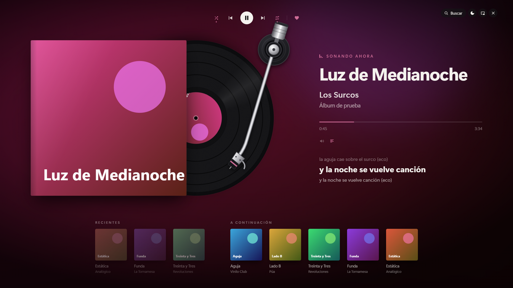
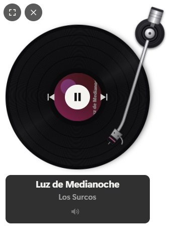
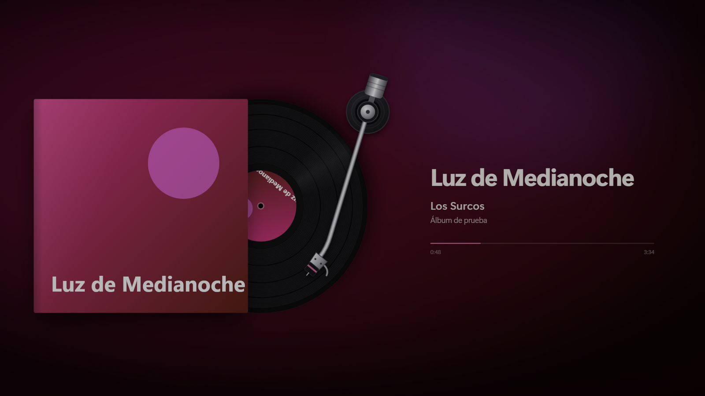

# Vinilify 💿

Lo que suena en tu Spotify, como un vinilo girando. Sin cuentas ni configuración: abre Spotify en tu PC y el vinilo empieza a girar.



- **Mini vinilo flotante**: siempre por encima de las demás ventanas. Se arrastra con el mouse; al pasar por encima muestra el tema, los controles y el volumen. Doble clic abre la pantalla completa.
- **Pantalla completa**: se abre en la pantalla que elijas (por defecto la secundaria). Muestra el vinilo con su funda, el brazo que avanza con la canción, el fondo con los colores de la portada, la **letra sincronizada** y las portadas de lo que sonó antes. Tiene aleatorio, repetir y Me gusta. Mientras está abierta, el monitor no se apaga solo.
- **Modo protección de pantalla**: para dejarlo en una segunda pantalla. Atenúa la imagen, deja solo el vinilo, el título, el artista, el álbum y la línea de tiempo, y lo mueve muy lentamente para que nada quede fijo. Se activa con el botón de la luna o solo, tras 5 minutos sin pasar el mouse por la ventana.

| Mini vinilo | Modo protección |
|---|---|
|  |  |

Todo se maneja desde el icono de Vinilify en la bandeja del sistema: clic derecho abre el menú y doble clic muestra el mini vinilo. También hay menú con clic derecho sobre el vinilo.

## Descargar

1. Descarga `Vinilify-Setup-x.x.x.exe` desde [Releases](https://github.com/MartinQuiri/vinilify/releases/latest).
2. Ábrelo. Como el instalador no está firmado (firmarlo cuesta dinero), Windows puede mostrar **«Windows protegió su PC»**: pulsa **Más información → Ejecutar de todas formas**.
3. Abre Spotify y pon una canción.

Requiere Windows 10 u 11 y la app de escritorio de Spotify.

## Cómo funciona

Vinilify lee la app de escritorio de Spotify a través de Windows (lo mismo que muestra el panel de volumen), así que **no necesita iniciar sesión ni Premium**. La música tiene que estar sonando en la app de Spotify de ese mismo PC.

| Sin cuenta (por defecto) | Con cuenta de Spotify conectada (opcional) |
|---|---|
| Vinilo, portada, título, artista y álbum | Todo lo de la izquierda |
| Reproducir / pausar, anterior, siguiente | **Buscador** de canciones, artistas, álbumes y playlists |
| Línea de tiempo (se puede arrastrar) | **A continuación**: la cola, y elegir qué suena |
| Volumen de Spotify en el mezclador de Windows | **Me gusta** y **agregar a la cola** desde el buscador |
| Aleatorio y repetir | Funciona aunque Spotify suene en otro dispositivo |
| Letras sincronizadas | |
| Recientes (Vinilify guarda su propio historial) | |

Las letras vienen de [LRCLIB](https://lrclib.net) (gratis, sin cuenta). Sin cuenta conectada, la portada grande se busca en alta resolución en iTunes y solo se usa si coinciden título, artista y duración; si no, queda la que entrega Windows.

### Conectar la cuenta (opcional, unos 5 minutos)

Spotify solo deja buscar y ver la cola a apps registradas por cada usuario. Al pulsar **Buscar** en la pantalla completa (o desde el menú de la bandeja), Vinilify muestra una guía paso a paso:

1. Entra a <https://developer.spotify.com/dashboard> → **Create app**.
2. Nombre `Vinilify`, cualquier descripción y en **Redirect URIs** exactamente `http://127.0.0.1:8888/callback`.
3. Marca **Web API**, acepta los términos y guarda.
4. Copia el **Client ID** en Vinilify y pulsa **Conectar**; autoriza en el navegador.

Spotify pide que la cuenta que crea la app tenga Premium.

## Atajos (pantalla completa)

| Tecla | Acción |
|---|---|
| `Esc` | Salir de pantalla completa |
| `Espacio` | Reproducir / pausar |
| `←` / `→` | Anterior / siguiente |
| `Ctrl+F` o `/` | Buscar |
| `L` | Mostrar / ocultar la letra |
| `P` | Modo protección de pantalla |

## Privacidad

Todo se queda en tu PC, en `%APPDATA%\Vinilify\`: `settings.json` (posición y tamaño del mini, pantalla elegida), `history.json` (recientes) y, si conectas la cuenta, `spotify.json` (Client ID y tokens de acceso, **cifrados con tu usuario de Windows**). Vinilify no tiene servidor propio: solo habla con Spotify, LRCLIB e iTunes.

## Desarrollo

```bash
npm install
npm start        # mini vinilo + icono en la bandeja
npm run full     # abre directo en pantalla completa
npm run demo     # datos de prueba, sin Spotify
npm run dist     # genera el instalador en dist/
```

Hecho con [Electron](https://www.electronjs.org/). La lectura de Windows está en `src/media/media-helper.ps1` (PowerShell, incluido en Windows).

## Licencia

[MIT](LICENSE)
